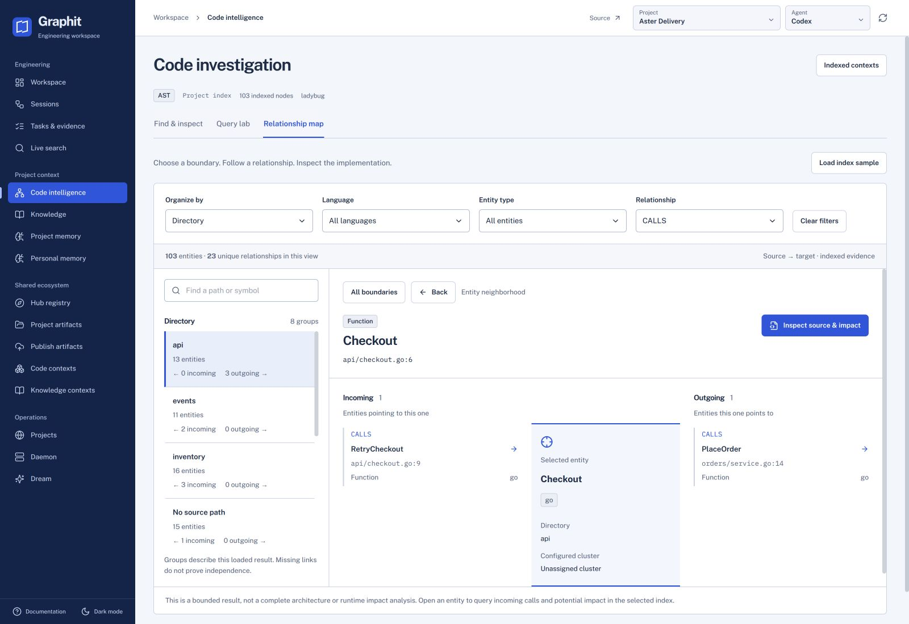
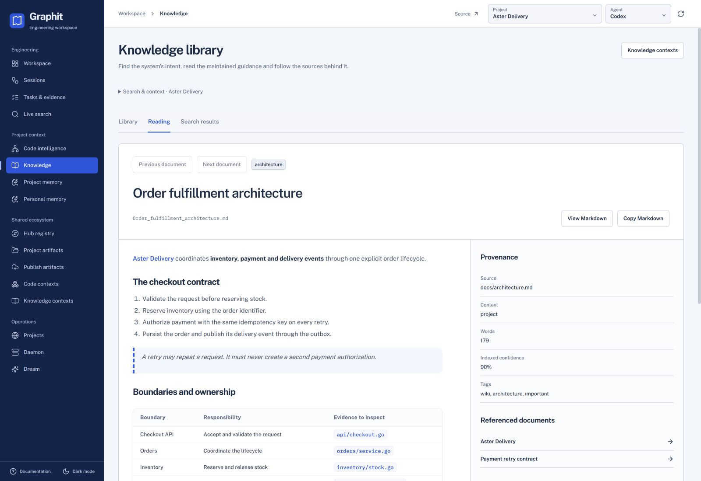
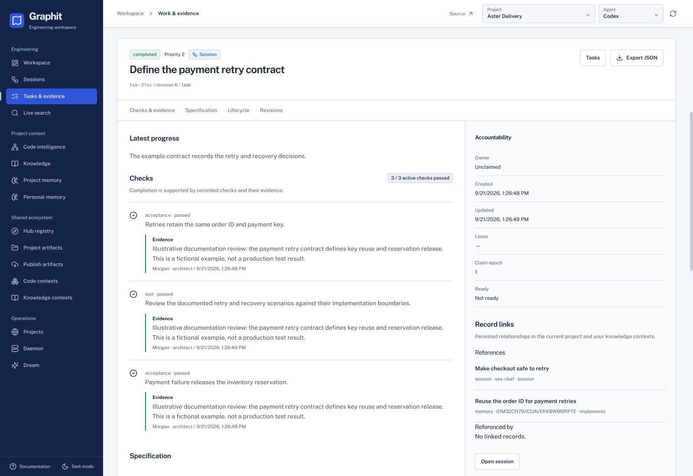

<p align="center">
  
</p>

<h1 align="center">Graphit Code</h1>

<p align="center"><strong>The context and control plane for AI software engineering.</strong></p>

<p align="center">
  <a href="https://github.com/graphit-labs/graphit-code/releases/latest"></a>
  <a href="https://github.com/graphit-labs/graphit-code/actions"></a>
  <a href="LICENSE"></a>
  <a href="https://github.com/sponsors/lainosantos"></a>
</p>

<p align="center">
  <a href="https://graphit-labs.github.io/graphit-code">Website</a> ·
  <a href="#install">Install</a> ·
  <a href="#first-run">First run</a> ·
  <a href="docs/guides/configuration.md">Configure</a> ·
  <a href="docs/README.md">Documentation</a> ·
  <a href="CONTRIBUTING.md">Contributing</a>
</p>



*From a code boundary to a directed relationship and its indexed source. Aster Delivery is a fictional demonstration project.*

## AI agents need more than a prompt

Models are probabilistic. Engineering needs explicit state, evidence and continuity.

Coding agents usually enter a repository with four blind spots:

- source text does not tell them the exact structural relationships in the code;
- a new session does not remember yesterday's correction or architectural decision;
- concurrent agents can duplicate work, overwrite ownership, or stop without a resumable checkpoint;
- documentation, sibling projects, and reusable agent tooling live in disconnected places.

Graphit closes those gaps with one local-first system that works across agents, IDEs, repositories,
machines, and model providers:

| Signal | What Graphit provides | What the agent can do |
|---|---|---|
| **AST** | Language-aware entities, source, and exact graph relationships | Find candidates with FTS + vectors, then prove callers, imports, inheritance, dependencies, and impact with Cypher |
| **Knowledge** | A compiled wiki built from maintained project documentation | Search pages, read only the relevant source, follow cross-references, and verify provenance |
| **Memory** | Durable project and user scopes with revision history | Carry corrections, conventions, decisions, and learned procedures across sessions and repositories |
| **Task** | A shared LanceDB scheduler with fenced claims, dependencies, checks, comments, immutable audit history, and complete JSON export | Coordinate parallel agents, make takeover safe, inspect work in the Task Explorer, and make incomplete work impossible to close |
| **Hub** | A versioned registry for reusable agent capabilities and contexts | Share rules, skills, agents, commands, MCP servers, languages, ASTs, and knowledge across systems |
| **Observatory** | One operational workspace over the same stores agents use | Explore code, docs, memory, live runs, daemon state, Dream, and ecosystem projects without a second data model |

Graphit does not make a language model deterministic. It adds reproducible queries, explicit
ownership, durable state and deterministic lifecycle gates around whichever coding agent you choose.

Graphit's goal is software engineering, not optimizing token counts. Preserve the system knowledge
you have already paid AI to acquire: record decisions, maintain source-backed documentation and carry
verified work forward. Individuals, teams and enterprises can build progressively on that foundation
instead of reconstructing it in every session.

## Built for teams, agents, and software ecosystems

- **One project, many agents.** Atomic claims and fencing tokens prevent stale writers; checkpoints,
  typed decisions, and `next_step` let another agent resume without reconstructing the work.
- **One engineer, many systems.** Project memory stays repository-specific while user memory follows
  personal conventions across projects. Registered sibling projects retain independent stores.
- **One team, many machines.** S3-backed providers share versioned Hub artifacts and authoritative
  Memory/Task LanceDB tables. S3-enabled Broker providers receive restricted in-memory temporary
  credentials per project/user/Hub scope and physical module while
  deny-by-default ACLs and IAM policy govern the remote prefixes.
- **One framework, many assistants.** Native adapters support Codex, Claude Code, Cursor, AGY,
  Kiro, OpenCode, Antigravity, Qwen Code, and Kimi Code; any MCP client can use the server endpoint.
- **One query, several retrieval modes.** BM25 full-text search, semantic vectors, hybrid reciprocal
  rank fusion, exact graph traversal, and source slicing serve different evidence needs.

## Repository quality gates

This repository declares Git commands in `.graphit/project.json` under root `githooks`, alongside its stable identity and `settings`.
Use Git 2.54+ and `graphit git install`; project setup also installs the native registrations.
`graphit git sync` and the project-wide `graphit sync` reconcile added/removed events.
Git stores one portable dispatcher per event; changing its command array takes effect
without reinstalling. Task/Memory notifications share that dispatcher. Agent context hooks
from `graphit coordinator install` / `graphit hooks install` remain a separate integration.
See [Git hooks](docs/guides/git-hooks.md) for configuration, shell, input and failure semantics.

An agent may push only when the engineer explicitly requests that push. Hook
success does not authorize a commit or push.

```text
pre-commit: git diff --cached --check → actionlint → cargo xtask check
pre-push:   cargo xtask check → strict workspace Clippy → locked xtask tests
```

`pre-commit` enforces native safety, staged whitespace, workflow lint and Rust formatting.
`pre-push` runs strict workspace Clippy and the locked `xtask` tests. After
`cargo fetch --locked`, run `cargo --offline xtask gate` for the standard Rust
checks or `make test TEST=graphit-ast/source_ranges` for an affected suite.
CI also runs the React checks and workflow validation. Release packaging
and native model/S3 qualification use the separate release workflow.
See the [product architecture guide](docs/development/product-architecture.md)
for component boundaries and validation commands. The [Rust workspace
guide](docs/development/rust-workspace.md) explains how Cargo prepares the locked shared Now wire crate.

## The Graphit Observatory

The web UI is an operational view over the same project context exposed to agents. On a local
desktop with a supported system tray, choose **Open UI** from the Graphit icon to open the
daemon's UI in your browser.

### Retain intent with its sources



Read maintained guidance beside its provenance and linked documents. The example describes Aster
Delivery's checkout boundaries and payment retry contract.

### Review the contract and the evidence



Inspect checks, evidence, specification, lifecycle and persisted record relationships. The displayed
review evidence is illustrative; it does not represent a production test run.

All screenshots use an isolated, fictional English project. No customer or maintainer workspace is
shown. See the [code investigation guide](docs/guides/code_investigation.md) and
[screenshot maintenance guide](docs/guides/product_screenshots.md).

## Install

Release targets are Linux AMD64, macOS ARM64, and Windows AMD64.

### Linux or macOS

```bash
curl -fsSL https://raw.githubusercontent.com/graphit-labs/graphit-code/main/install.sh | sh
```

### Windows PowerShell

```powershell
irm https://raw.githubusercontent.com/graphit-labs/graphit-code/main/install.ps1 | iex
```

The installers verify the release checksum and install both Rust executables with their runtime assets. Preserve the complete package, including `graphit-runtime` and the app-local DLLs on Windows. Redistributable native libraries are included; operating system libraries and optional GPU drivers remain supplied by the host. Pin a release with `--version <tag>` (`-Version` in PowerShell). See the [getting started guide](docs/guides/getting_started.md) for custom paths, complete release layouts and source builds.

## First run

Configure and maintain an existing project with the Rust SDKs. Install local
EmbeddingGemma2 explicitly when semantic search is needed:

```sh
graphit models install embeddinggemma2
cd your-project
graphit setup --agent kiro-v3 --project-dir .
graphit coordinator install
graphit daemon status
```

Setup persists the binding, creates or reuses the project identity and admits its
checkout to the daemon. The Coordinator command publishes the bundled Kiro V3
agent, MCP configuration and PROJECT hooks; use the returned profile and complete
the host's trust/reload steps. Kiro V3 is the supported Kiro engine; ACP consumers
launch `kiro-cli acp --agent-engine=v3` explicitly.

`graphit setup --agent <binding>` configures only the installation when no project
directory is supplied. Model downloads and named account login are separate,
explicit operations. A valid identity still needs the applicable PROJECT access.
See [Getting Started](docs/guides/getting_started.md),
[authentication](docs/guides/authentication.md) and
[agent hook activation](docs/guides/agent_hook_activation.md) for the complete
workflow, configuration and error recovery.

## Optional deployment: server for teams and enterprise

The maintained Linux image runs the Rust daemon as PID 1. MCP and the configured
browser share its Source listener on port 8081. Remote agents bring their own
models; project data remains protected by the configured Broker authentication
and PROJECT authorization.

```sh
docker volume create graphit-global
docker run -d --name graphit \
  -p 127.0.0.1:8081:8081 \
  -v graphit-global:/home/graphit/.graphit \
  ghcr.io/graphit-labs/graphit-code:latest
```

The private volume belongs to UID/GID 10001. Configure trusted Broker providers,
the browser PROJECT endpoint and the actual public browser origin for a team
deployment. Each instance owns its installation volume; repositories are mounted
and registered separately.

See the [container guide](docs/guides/container.md) for a local build, current
environment names, browser configuration, startup scripts, health, shutdown and
derived images with an assistant CLI. The release workflow publishes semantic
image tags without the Git tag's v prefix.

## What agents gain

### Find broadly, then prove structurally

Graphit indexes declarations and relationships from Tree-sitter and ANTLR grammars into an
Icebug/LadybugDB graph. A separate Lance sidecar combines BM25 full-text and semantic vector results
with reciprocal rank fusion. Agents use ranked search to find the likely entity, exact Cypher to
establish relationships, and a source call to read only the relevant lines.

```cypher
MATCH (caller)-[:CALLS]->(target:Function {name: 'RunSync'})
RETURN caller.name, caller.path
```

The graph opens on the fly from Icebug files into an in-memory catalog, so published contexts remain
portable without running a separate graph server. Optional local, direct, or broker-based
second-stage reranking is active in AST and Knowledge searches when `search.rerank=true`. See the
[AI Engine specification](docs/specs/ai_engine.md).

### AST language support

The AST ships **45 profiles covering 44 language and format entries**, plus embedded PL/pgSQL. The default discovery profiles cover:

| Area | Languages and formats |
| --- | --- |
| Application and systems code | C, C++, C#, Clojure, Dart, Elixir, Go, Groovy, Haskell, Java, Julia, Kotlin, Lua, Objective-C, PHP, Python, R, Ruby, Rust, Scala, Swift, Zig |
| Web | JavaScript (including JSX), TypeScript, TSX, HTML, CSS, Svelte, Vue |
| Data, interfaces and configuration | SQL, GraphQL, Protocol Buffers, JSON, XML, YAML, TOML, HCL, Dockerfile, Bash |
| Legacy systems | COBOL 85 |

**Explicit SQL dialects:** Oracle PL/SQL, PostgreSQL, DB2 and T-SQL use ANTLR profiles selected through `ast.grammar`; `.sql` otherwise uses Tree-sitter SQL. HTML, Vue and Svelte can also index supported embedded script/style languages. PostgreSQL supports embedded PL/pgSQL bodies.

Support is profile-specific: entities, relationships and resolution depth differ by language. Registered extensions are routing rules, not a promise to support every dialect or variant. See the [complete language and extension matrix](docs/specs/ast_module.md#supported-languages), [embedded parsing](docs/specs/embedded_language_parsing.md) and [grammar configuration and extensibility](docs/guides/ast_extensibility.md). Markdown documentation is handled by Knowledge rather than the default AST profiles.

### Source-backed knowledge

The knowledge module compiles `docs/` and the root README into a searchable wiki. Pages retain their source, confidence, links, and update history; agents read the selected page after search instead of treating a ranked title as the answer.

### Memory that survives the session

Project memory captures repository-specific decisions and corrections. User memory captures portable personal conventions. Both are stored outside the checkout and exposed through the same search-and-read workflow.

### Deterministic control that survives the agent

Graphit Task keeps shared work in the project's authorized Task dataset and native version branch,
locally or directly in S3 according to the selected provider. Agents claim ready Tasks, record
progress, revise scope with expected-revision fencing, supersede obsolete checks with a reason,
and verify active checks before completion. IDs are canonical ULIDs. Pending descendants and
prerequisites retain their real gates; completed or cancelled children are terminal, and cancelling
a child does not prove the parent's required functionality. Cancellation and removal are explicit
operations rather than automatic consequences of a change of direction. CLI, MCP and Browser
read the same Records services. Exact reads return current state; history and comments are
requested explicitly through snapshot-bound pages. See the [Task contract](docs/specs/task_module.md)
and [Session workflow](docs/guides/task-sessions.md).

### Reusable context across systems

Registered sibling projects keep their own AST, wiki, and memory. Hub artifacts package reusable capabilities when a project or team intentionally publishes them. An optional broker exposes shared catalogs and published contexts through short-lived per-operation URLs; everyday local operation does not require a hosted database.

### Ephemeral synthesis across several sources

Live Search prepares a throwaway project from selected Hub artifacts, installs the requested agent
environment, streams a bounded agent session, and removes the project data when the session is
deleted. It is the on-the-fly path for questions that genuinely span several codebases or knowledge
bundles; direct AST, Wiki, Memory, and Task tools remain the cheaper path for focused questions.

## Configure the operating model

| Goal | Setting |
|---|---|
| Keep everything local | configure no broker and use local embedding/rerank modes |
| Share Hub artifacts | configure S3 on a local provider or use a Broker provider that advertises `graphit-s3-credentials-v3` |
| Use enterprise SSO | configure a Broker provider; the Broker owns local and external IdP login and issues the tokens Graphit accepts |
| Run without an installed coding-agent CLI | `modules.agent=false` |
| Keep autonomous Dream work off/on | `modules.dream=false` (default) or `true` |
| Serve the Observatory from the daemon | `modules.daemon_ui=true` |
| Disable the daemon filesystem watcher | `modules.sync=false` |
| Disable background embedding work | `modules.embedding=false` |
| Select a remote embedding backend | use a brokerless provider with `--embedding-mode direct`, or configure a broker with both embedding and rerank modes set to `broker`; then supply account secrets through `graphit login` |
| Select a remote rerank backend | use native Cohere/Voyage/Jina or embedding-simulated OpenAI/OpenAI-compatible/Google with `--rerank-mode direct`; simulated modes also require `--rerank-dimensions` |
| Restrict indexed languages | `ast.grammars_whitelist` / `ast.grammars_blacklist` |
| Move or narrow the documentation tree | `knowledge.docs_dir`, `knowledge.extensions`, `knowledge.include_readme` |

Ordinary keys use captured command, environment, project, global and distribution layers;
installation-only settings and provider/account topology have their own scope rules. The [complete configuration reference](docs/guides/configuration.md) documents every key,
default, switch, provider, network boundary, and runtime resource control.

## Security boundary

- Mutable project sources and compiled local stores remain on the machine by default.
- Hub publication is optional. When enabled, Graphit mounts S3 directly. Local providers use the
  configured AWS identity; Broker providers receive short-lived, scope-specific temporary
  credentials only in process memory when storage is configured or the Broker advertises
  storage. Without that capability, the authenticated Broker profile uses local storage.
- S3 is authoritative for Hub artifact data; broker SQL or standalone `projects.json` is selected
  as the provider's one ACL authority. `~/.<brand>/hub` is only a bounded, subject-isolated metadata
  cache; it never grants access or replaces remote validation.
- A project name is mutable discovery metadata. Its immutable ULID owns remote paths, locks, and exact grants.
- Source/UI bind according to `mcp.host` and `mcp.port`. The optional trusted `task.browser`
  configuration enables Broker browser login and verified data APIs; absent configuration is
  headless, not anonymous access to all project data. Use HTTPS for exposed deployments.
- Network controls and exact-origin CORS complement authentication and PROJECT authorization;
  they do not replace either.
- Local work uses its active profile. HTTP MCP verifies each caller's Broker access token and carries that
  same bearer to Broker APIs; local providers may use a static
  broker key. The Broker maps its current ACL to a short-lived STS session policy; S3 bucket/IAM
  policy remains the final data-plane boundary and object bodies travel directly between Graphit and S3.

See [S3 STS storage and UI network configuration](docs/guides/s3-and-ui-network.md) before exposing the UI or configuring shared storage.
The normative contracts are [Project identity](docs/specs/project_identity.md),
[Hub access control](docs/specs/hub_access_control.md), and
[Hub S3 object layout](docs/specs/hub-s3-object-layout.md).

## Documentation

Start with the document that matches your intent:

- [Getting started](docs/guides/getting_started.md) — install and initialize a project.
- [Authentication](docs/guides/authentication.md) — local and Broker profiles, browser login,
  opaque Browser sessions, and HTTP MCP access.
- [OIDC integration](docs/guides/oidc-integration.md) — register native consumer and confidential broker-admin clients, map claims, propagate HTTP MCP identity, configure web-identity STS, and troubleshoot Keycloak, Entra ID, or Auth0.
- [Graphit Broker](docs/guides/auth-broker.md) — operate the SQL/OIDC/RBAC control plane, centralize transactional consumer ACLs, issue restricted STS sessions, and own embedding/rerank credentials, routes and caches.
- [User manual](docs/guides/user_manual.md) — daily workflows and operational concepts.
- [Configuration reference](docs/guides/configuration.md) — every setting, default, feature switch, provider, and environment override.
- [AI models, providers, and agent CLIs](docs/guides/ai_models.md) — completion delegation, every CLI protocol, embedding models, credentials, dimensions, rerank, and local/remote boundaries.
- [Daemon operations and monitoring](docs/guides/daemon_operations.md) — user service, Linux fallback, system tray, watched signals, MCP, logs, parking, and recovery.
- [Capability and surface matrix](docs/guides/capability_matrix.md) — every module, CLI/MCP/UI exposure, gate, and current limitation.
- [Filesystem, state, and watchers](docs/guides/filesystem_contract.md) — special files, generated state, adapter layouts, and change detection.
- [AST grammars and parser extensibility](docs/guides/ast_extensibility.md) — every YAML field, selector, parser extension path, precedence rule, and validation workflow.
- [CLI reference](docs/guides/cli_reference.md) — commands and flags.
- [MCP tools reference](docs/guides/mcp_tools_reference.md) — agent-facing tool contracts.
- [Architecture overview](docs/architecture/architecture_overview.md) — system boundaries and data flow.
- [Storage layout](docs/architecture/storage_layout.md) — what lives in a project and what lives globally.
- [Task module](docs/specs/task_module.md) — shared lifecycle, ordered batches, durable claims, checks, hooks, and takeover guarantees.
- [UI specification](docs/specs/ui_dashboard.md) — Observatory behavior and backend contract.
- [Design system](docs/specs/design_system.md) — shared principles, tokens, interaction patterns and evolution rules for Code, Broker and the site.
- [Documentation hub](docs/README.md) — the complete maintained documentation map.

Task history lives in the authoritative LanceDB tables; changelogs and accepted decisions remain documentation evidence. The documentation hub separates historical records from current operational guidance.

## Build from source

Use the Rust toolchain pinned in `rust-toolchain.toml`, Node.js 22, Make, CMake and
a C++20 toolchain with `<format>` support (GCC/libstdc++ 13 or newer on Linux).
Cargo resolves official pinned dependency sources. The maintained Make targets
prepare Ladybug once through `cargo xtask cargo`, without a separate SDK. See
[native packaging](docs/development/native-runtime-packaging.md) for native
prerequisites and optional GGUF accelerator builds.
Distributed executables use optimized Cargo Release with static symbols removed;
`make release` packages the exact artifacts reported by that build.

```sh
npm --prefix ui ci
make ui
make build
```

See [Getting Started](docs/guides/getting_started.md#build-from-source) and
[native packaging](docs/development/native-runtime-packaging.md) for the complete
product layout and current build commands.

## Project status

Graphit Code is under active development. Interfaces, storage formats, and supported integrations may evolve between releases. Prefer the documentation on the same branch or release as the binary you are using.

## License

Licensed under the [MIT License](https://github.com/graphit-labs/graphit-code/blob/main/LICENSE).

If Graphit improves your agent workflow, consider [sponsoring its development](https://github.com/sponsors/lainosantos).
