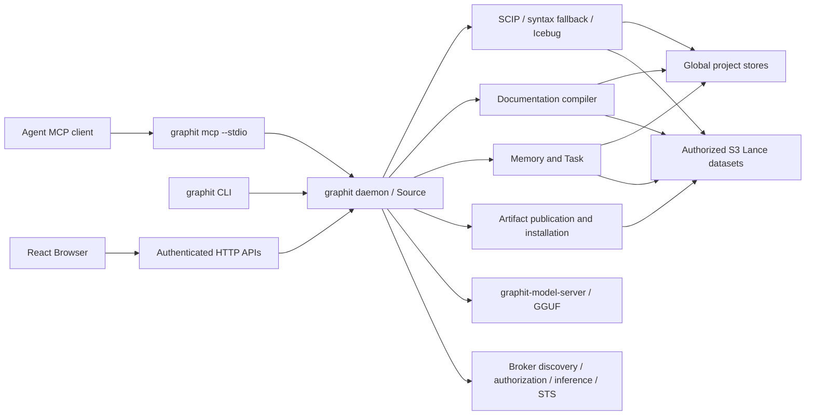

# System Architecture Overview

Graphit is a Rust application with a React/TypeScript Browser. It maintains code intelligence,
project documentation, durable records and installed agent capabilities.
Start with [Getting started](../guides/getting_started.md)
for installation and [the system contracts](system_contracts.md) for implementation boundaries.

## Topology

## Runtime layers

The release contains `graphit`, `graphit-model-server` and their runtime assets. `graphit` implements
the CLI, daemon, MCP stdio proxy, tray and hook entrypoints.
The [complete release layout](../development/native-runtime-packaging.md) is the unit of installation;
copying one executable does not preserve the native library closure or model support.

The daemon is one installation-wide owner of retained project/version selections, watchers,
background jobs, HTTP/MCP listeners and model-process supervision. Domain work runs through the
Rust services in that process; it is not a CLI subprocess for every changed file. Coding-agent
CLIs and specialized Docker SCIP indexers are external processes with owned cancellation and
joined termination. The Linux tray is a separate `graphit tray` process and does not own stores.

The MCP stdio process forwards SDK messages to the authenticated Source endpoint. It does not
open a graph or load models merely to list tools. Closing its stdin closes that client, not the
daemon. Root, Role and Live credentials have different grants and catalogs; a Role credential
cannot be promoted to Runtime authority. See [MCP](../specs/mcpstdio_module.md).

The daemon serves the embedded Browser assets and JSON APIs. The Browser uses verified cookie
identity for downstream admission. Rendering a project name or carrying its ID in a URL never
grants access. There is no separate Browser database. See [authentication](../guides/authentication.md)
and [daemon operation](../guides/daemon_operations.md).

## Data planes

### AST

SCIP is the indexing interchange format. Maintained or configured specialized Docker indexers
produce compiler-aware documents; the generic Tree-sitter/ANTLR fallback also produces SCIP.
ANTLR language parsers/runtime remain C++ behind the existing cxx bridge; Rust coordinates the
pipeline and consumes extracted facts. Custom Docker routes use `ast.scip.parsers`, not a
loadable native grammar plugin. [Parser extensibility](../guides/ast_extensibility.md) defines the
image contract, profile layers, captures and diagnostics.

Source is persisted once per file in its own Lance dataset. Searchable entities and nullable
embeddings share `ast/corpus.lance`. Structural nodes, relationships and CSR members are published
as immutable Icebug Parquet shards with an atomic manifest. Ladybug queries these through an
in-memory database, for both local paths and authorized remote ranges. A local `.lbug` database
is not authoritative storage. Completed FILE publications support Cypher/FTS before all files or
embeddings finish. [Indexing](../guides/indexing.md) explains full and incremental availability.

### Knowledge

Maintained Markdown/document sources, README inclusion and ignore rules feed a per-file compiler.
The authoritative document rows, lexical fields and embeddings share `knowledge/index.lance`.
Publication happens progressively; inference cannot block completed text. Source provenance,
compilation fingerprints, references and committed synchronization history remain distinct from
an agent's generated answer. Ask and Conversation use an explicit completion binding and the
same authorized retrieval. See [Knowledge](../specs/wiki_module.md).

### Memory and Task

Memory stores current content, revisions, references and compatible vectors in one dataset per
PROJECT corpus, or in a separate verified USER corpus. Task stores tasks, sessions, checks,
comments, claims, history and searchable public projections in one PROJECT dataset. Both use
native Lance branches for project versions and preserve snapshots used by Git tags.

Writes enforce authenticated scope, revision/CAS and domain invariants; a copied token or cached
artifact is not a write grant. Cancelled descendants are terminal but do not prove the parent's
required work was delivered. [Task](../specs/task_module.md), [Memory](../specs/memory_module.md)
and [Git records](../specs/git_records.md) define these state machines.

### Hub and agent files

The Hub discovers authorized artifact catalogs, publishes versioned packages and installs
exact selected artifacts. Native AST/Knowledge contexts can be read without copying a repository.
The current package is the canonical source of Graphit's bundled instructions; installations keep
origin/version/hash and concrete ownership state, not another `owned-payloads` copy.

`graphit sync` reconciles installed Hub versions and the native roles/skills/Coordinator/hooks/MCP.
It does not upgrade remote artifacts, perform Git clones or wait for indexing. `hub update` is the
explicit remote-version operation. Stop hooks request asynchronous PROJECT index rescans.
See [artifact lifecycle](../specs/hub_collaboration.md) and [CLI](../guides/cli_reference.md).

## Local and Broker operation

Local stores live below the private global directory, keyed by stable PROJECT ID and corpus,
not checkout pathname. The checkout keeps identity, shareable configuration and maintained
sources. Project versions are native dataset branches, not copied corpus directories.

When Broker discovery authorizes S3, Memory/Task and installed context consumers access the
remote storage directly with scoped temporary credentials. No local upload queue or second
source of truth participates. Authentication/STS/storage failure is explicit; valid discovery
that disables S3 can select the local backend. [Storage layout](storage_layout.md) specifies paths.

An active Broker provider permits only Broker or disabled embedding/rerank. A Local provider can
select local, direct, Broker or disabled services independently. Local GGUF uses the shared
llama.cpp/cxx process with independent embedding/rerank devices. CPU is default; rerank is opt-in.
No remote service selection requires local model weights. [AI contracts](../specs/ai_engine.md)
separate completion, vector space, rerank and hardware decisions.

## Cross-cutting contracts

- Original cancellation/deadline and current admission are retained through IO, native work and
  delivery. Completion of a write followed by a delivery error is reported honestly; timeout
  does not imply rollback or permission to retry blindly.
- Access JWTs are verified locally with trusted keys and complete claim checks until expiration;
  project authorization remains separate. Revocation/account/claim changes can be delayed until
  the access token expires. Discovery/JWKS and valid STS sessions are reused.
- New reads capture fresh committed heads; an existing reader can retain a coherent snapshot.
  Credentials and snapshot freshness are separate concerns.
- Paths persist as Unicode JSON strings and use standard Path/PathBuf internally. Invalid Unicode,
  NUL, traversal or unauthorized roots fail; strings are not filesystem authority.
- CLI/HTTP keep JSON contracts. Structured MCP output defaults to TOON text, with explicit
  `ai_optimized:false` for JSON and no duplicate full JSON in TOON mode. Original text stays text.

## Implementation map

| Responsibility | Maintained owner |
|---|---|
| CLI/composition, HTTP/MCP/Browser and hooks | `crates/graphit-app` |
| Watchers, jobs and local model supervision | `crates/graphit-daemon` |
| Config, identity, paths, Git facts, IO/locks and output | `crates/graphit-core` |
| Auth identity, profiles, JWT and service admission | `crates/graphit-auth` |
| Lance, corpus storage, native graph and publication | `crates/graphit-data` |
| Parsing, SCIP adaptation and AST extraction | `crates/graphit-ast` |
| Documentation compilation and retrieval | `crates/graphit-knowledge` |
| Memory/Task state and Git record merge | `crates/graphit-records` |
| Model manifests, GGUF bindings and agent protocols | `crates/graphit-ai` |
| Artifact lifecycle and host-native installation | `crates/graphit-hub` |
| Supervised processes / instruction templates | `crates/graphit-process` / `crates/graphit-runtime` |
| Browser consumers and design system | `ui/` |

Historical qualification receipts are evidence for their named source/platform only. Current
source support, an installed Linux journey and published Windows/macOS artifacts are different
claims. Do not infer native platform execution from a prepared workflow.
