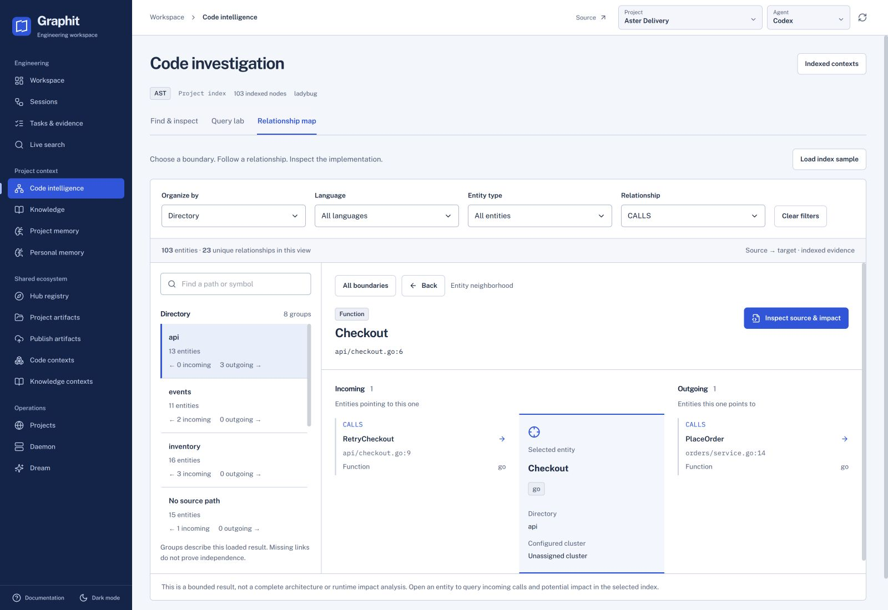

# Investigate code relationships



*Fictional Aster Delivery project. Follow RetryCheckout → Checkout → PlaceOrder, then open the indexed implementation.*


Use Code intelligence to understand an implementation, inspect the boundaries it crosses and identify code to review before a change. Start with an indexed project selected in the common header, or open an installed Code context.

## Read structure before following a symbol

1. Open **Relationship map**. On first entry, Graphit loads a bounded index sample unless a search or Cypher execution has already supplied the current result (including an empty or failed request).
2. Choose **Organize by**: Directory for source boundaries, File for individual implementations, Language for a cross-language view, or Configured cluster for project-defined path groups.
3. Select a boundary. Its reader lists entities and directed relationships crossing the boundary, and counts relationships internal to the group. Incoming points from outside into the group; outgoing points from the group to an outside entity.
4. Select an entity to query its direct neighborhood in the selected index, including entities outside the original result. Incoming entities appear on the left, the selected entity in the center and outgoing entities on the right. Each connection retains its relationship type. The selected entity appears immediately. One bounded request returns a page across incoming and outgoing relationship types; the reader shows that page without waiting for separate schema branches. **Load more relationships** requests the next page. Loading and failures stay in the reader; **Retry neighborhood** retries the pending page while retaining the relationships already loaded. On narrow screens these sections stack in reading order.
5. Follow a neighbor to continue exploring; **Back** returns to the preceding entity. **All boundaries** returns to the catalogue. Each selected neighbor triggers its own neighborhood query. The original result catalogue, counts and filters remain unchanged. No physics, camera positioning or color interpretation is needed to read direction.
6. Choose **Inspect source & impact** to open the implementation inside Relationship map. There you can read indexed source and explicitly query incoming, outgoing or potential-impact evidence against the selected index.

Use **Read entity source** to read the selected indexed entity by its observed
primary key and type within that file. Duplicate names do not choose the entity;
its UID and response-local address do not substitute for the key. The action is
available with an observed key and source path even when no name was published.
**Read complete file** remains a separate file read. A failed entity read keeps
the preceding source visible for an explicit retry; changing entities cancels the
old read and clears its source, including when both entities share a file.
The native result preserves the backend's source provenance and fingerprint.


The boundary search matches names and paths within the loaded result. Language, entity-type and relationship filters narrow that result; they do not fetch additional repository data. **Clear filters** recovers a filtered-empty view. The common header refresh reloads the current result source (search, Cypher or sample) and the selected neighborhood; exploration history remains available. A new explicit search or query clears the previous map filters and selection. Changing project or imported context resets the exploration.

## Understand what the numbers mean

An **entity** is an indexed node, such as a function, class, file or module. A **relationship** is an indexed occurrence with its own `uid`, source, type and target. Neighborhood pages identify an occurrence by its UID, relationship type, source label and typed public key, target label and typed public key, and a zero-based ordinal within that complete group. Repeated observations of the same complete position do not increase the count; occurrences with identical UID and endpoints remain distinct by their ordinal. Self relationships remain explicit.

Directory and file boundaries come from source paths. Language comes from indexed metadata. A configured cluster is a path-based grouping, **not an inferred community, team owner or architectural guarantee**. Missing path, language and cluster metadata have explicit fallback labels rather than guessed values.

Catalogue and boundary counts describe the **loaded result**, not the entire repository. A selected entity’s Incoming/Outgoing reader is separate: it queries direct indexed relationships beyond that result. Each page loads up to 100 relationships across directions and types; **Load more relationships** continues with the server’s unchanged opaque cursor. Counts describe the relationships loaded so far. Until continuation finishes, the reader labels its evidence as partial and does not describe an unloaded direction as empty. Projected typed entity keys and complete public relationship positions join repeated observations across pages; physical row addresses are used only within their own response. The reader has no graph-generation field or global snapshot gate. Changing an occurrence group does not preserve a snapshot of that group across earlier and later pages. Concurrent indexing can change later observations; use the common header refresh to start a new neighborhood read. A page failure retains successful evidence, and changing project, imported context or selected entity cancels the pending read and rejects its late result. The initial sample includes up to 300 initial nodes and the endpoints of up to 1,000 relationships, so it can contain more than 300 entities. It has no completeness guarantee. Catalogue filters remove connections to hidden result endpoints, but do not hide independently queried neighbors. No visible link does not prove independence; dynamic dispatch and unresolved calls may be absent even in a wider query.

The selected entity shows its name, type, source file, exact line and current project/version or installed artifact/version. The UID is opaque: its compact display does not interpret JSON-looking text or use it as a file path. **Copy UID** copies the complete literal value. Open **Technical entity details** to select the full UID manually, inspect the observed primary key and response-local address, or copy the structured entity details. Copy feedback reports a successful clipboard write or its failure.

## Ask a precise question

Use **Find & inspect** for full-index ranked search and **Query lab** for a reproducible read-only Cypher question. Inspect the available schema and persistent identity before traversing. AI drafting produces an editable query; you decide when to run it. Both **Search index** and **Run query** immediately open **Relationship map**, where loading, errors and results appear. Query lab keeps the editable query when you return. Search matches retain their rank and available descriptions, with no invented relationships; select an entity to resolve its indexed identity and load its neighborhood automatically. Scalar rows appear in **Query rows** in the same workspace and are never converted into invented graph relationships. For mixed results, the graph appears first and Query rows can be expanded below it.

The AST and Knowledge search controls offer **Reranking → Use configuration / Off / On**.
Use configuration is the default and follows `search.rerank`, whose default is false;
choosing a provider does not enable reranking. Off disables it for that search even
when configuration enables it. On explicitly requests the configured reranker.
The choice applies to project and imported searches. Changing the query or reranking
choice clears the previous result and stops its pending request. Knowledge continuation
and retry retain that search's choice and exact publication cursor.

Results keep the server's order. **Rerank score** is separate from lexical score,
semantic distance and combined/RRF score; these values describe different stages
and are not interchangeable. A reranker failure is displayed as a service error,
without a silent fallback search.

Potential impact follows incoming calls up to two hops and returns up to 100 distinct indexed candidates. Review their source and relevant tests before concluding that a change affects them. See the [AST query and traversal contract](../specs/ast_module.md) and [supported languages](../specs/ast_module.md#supported-languages) for parser-specific boundaries.

## Recover from incomplete evidence

- **No graph entities:** load a sample, inspect the query table or check whether the chosen context has been indexed.
- **No matching entities:** clear filters or use a different name/path. Use full-index search if the entity is outside the sample.
- **No source path:** the entity may represent an external or structural node. The index sample carries its persistent identity when available, so its relationships remain inspectable without a file; source is not fabricated.
- **Request failed:** read the error and use **Retry neighborhood** or the common header refresh. If the same read keeps failing after the daemon is available, update Graphit and reindex the selected project or context; Retry cannot repair an invalid persisted graph bundle. An error is not evidence of an empty repository.
- **Missing unique identifier:** refresh the result or reindex. Traversal needs the public primary key declared by the selected schema. Search and sample results carry that observed key, and a full node returned by Query lab retains it. A UID remains distinct from a primary key and from a source path. The map never guesses from a name, file or line.
- **Missing relationship UID:** reindex the selected context. Older graph bundles cannot support stable relation navigation. Ladybug's internal `ID(r)` identifies a relation in the current mounted snapshot and may change after reindexing.

The [design system](../specs/design_system.md) defines this stable, keyboard-accessible catalogue and evidence-reader pattern.

### Query safety with the current native engine

Icebug 0.19 has a multi-table relationship scan defect. Graphit reads physical
forward members separately for the map and for simple `MATCH (n)-[r]-(m)
RETURN n,r,m` queries, preserving each relation's UID. Other wildcard and
type-alternation forms can still be refused when their endpoints cannot be
verified. For a reached-node investigation, filter an anchor and project the
reached endpoint, for example:

```cypher
MATCH (a:Function)-[:CALLS]->(b:Function)
WHERE a.name = 'Checkout'
RETURN DISTINCT b.name
```

This example uses the fictional demonstration project. Substitute a function
from your own index. A native scan refusal is not an empty search result.
