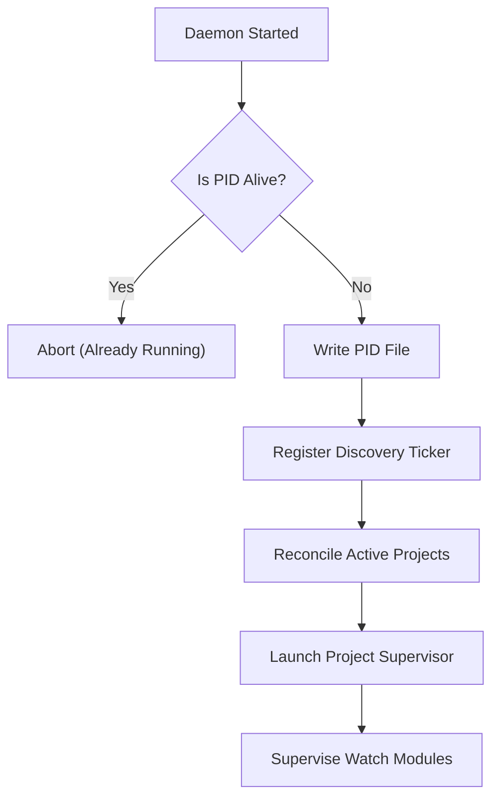

# Daemon Module Specification

The Daemon module runs a persistent, background supervisor process.
It discovers managed projects, shares the configured embedding backend, runs background loops,
serves authenticated MCP, and performs maintenance routines. See
[Daemon Operations and Monitoring](../guides/daemon_operations.md) for the user-facing runbook.

---

## ⚙️ Background Daemon Lifecycle

The daemon is designed to run as a single instance per machine, verified using a global PID lockfile (`~/.graphit/daemon/daemon.pid`).



### 1. Project Discovery & Handoff

Every 30 seconds (`DiscoveryInterval`) the discovery loop calls `ListActiveProjects()`
against the Global Lock Manager, which reads `~/.graphit/global.lock.json`.

> **`ListActiveProjects()` is misleadingly named.** It filters only by *the lockfile still
> exists on disk* — it does no activity filtering of its own. Deciding what is active is
> the daemon's job, below.

A registered project is in one of three states, and `reconcileProjects` moves it between
them on every tick:

| State | Meaning |
|---|---|
| **Supervised** | A `ProjectSupervisor` is running: filesystem watch, embedding loop, dream runner |
| **Parked** | Registered and known, but nothing is running for it |
| **Gone** | No longer returned by discovery — the supervisor is stopped and both entries dropped |

#### Parking: registered is not the same as supervised

Supervising every registered project forever meant a developer who had accumulated
dozens of them over time paid for an inotify watch tree, an embedding loop and a dream
runner on each, indefinitely. Parking bounds that to the projects actually being worked
on.

- **Supervised → parked** when `ProjectSupervisor.IdleFor()` exceeds the activity window.
  The idle clock is *pushed*, not polled: modules implementing `ActivityReporter` call
  `Touch()` as they observe changes, and `SyncModule` does so on every `fswatch` batch —
  even a batch with nothing reindexable in it. Demotion therefore costs no disk walk.
- **Parked or newly discovered → supervised** when `dream.LastModifiedTime(dir)` shows a
  change inside the window. This is the one direction that does walk the tree, because a
  parked project has no watch to report activity from. A walk that fails defaults to
  *active*, so a project is never parked on account of the probe itself failing.

#### Configuration

`daemon.activity_window` — a Go duration string, default `30m`. Setting it to `0`
disables parking entirely: every registered project stays supervised for as long as it
stays registered, which is the pre-parking behaviour. An unset or invalid value falls
back to the default.

The window is resolved **once**, at daemon start (`runDaemonCore`), not per reconcile
tick — re-resolving would read `~/.graphit/config.json` every 30 seconds. A `Daemon`
built directly, as the tests do, gets a zero window and therefore never parks.

### 2. Project Supervisors

Every module schedules work; none performs it in the daemon process. Each run is a `graphit` CLI
child started through `internal/clirun` with the project root as working directory, its output
appended to the project's `.graphit/runtime/daemon/daemon.log`, marked as background work (lower
priority, CPU budget) and cancelled as a process tree with the module's context. Tests replace the
package-level `cliRunner` to record invocations instead of starting processes.

A supervisor belongs to one checkout and one [project version](project_identity.md#project-version):
its key is `<project id>@<absolute dir>#<version>` (`supervisionKey`). Two worktrees of one repository
are two supervisors, and switching a checkout's branch replaces its supervisor with one for the new
version, which starts with a full `graphit sync`. Every child receives
`GRAPHIT_PROJECT_VERSION=<version checked out when it starts>` (`versionEnv`). One run therefore never
switches stores halfway through a branch change, and a version pinned in the daemon's own
environment never reaches a project's child.

Each active project has an isolated supervisor thread monitoring watch modules:
- **`SyncModule`**: Holds one recursive filesystem watch over the project tree (`internal/fswatch`) and reindexes what each batch names. Debounces 1 second of quiet, capped at 5 seconds for a continuously busy tree. Classification stays in the daemon; the work runs as children:
  - **Watcher start (`Rescan`)** — `graphit sync`, because a parked supervisor had no watcher and anything, deletions included, may have changed.
  - **Each batch** — `graphit hub hydrate --json` first, unless the project cannot have a published Hub base (no lockfile project ID, or a non-Broker provider without Hub storage; `hubStorageMayExist`); a changed published AST base turns the batch into `graphit ast index` (whole-project reconcile), otherwise `graphit ast index --changes-from -` receives `{"changed":[…],"removed":[…]}` project-relative paths on stdin (never as arguments, which would meet the Windows command-line limit). A documentation change or a changed published Knowledge base adds `graphit knowledge index`.
  - **AST graph** (LadybugDB) — the `--changes-from` run is the incremental pipeline over the exact changed paths (`ast.RunPipelineForPaths`), which skips discovery entirely
  - **Knowledge wiki** — recompiles from the configurable docs directory (`knowledge.docs_dir`, default `docs`) plus the root README (`knowledge.include_readme`), assembled by `knowledge.ScopeFor`. A project with a README and no docs tree yet still gets a wiki; only when neither exists does the reindex return without running the pipeline.
  - **One watch, two ignore files.** The watch covers the *union* of what the AST and the wiki care about; each consumer then applies its own file (`.astignore`, `.wikiignore`) to what arrives. Building the watch from the AST checker alone used to let `.astignore` silently decide whether the wiki heard anything — putting `docs/` in `.astignore` meant editing a document rebuilt nothing.
  - **Routing** (`classifyBatch`): AST ownership follows the extension and nothing else, exactly as a full scan decides it — which now means the docs tree is excluded, because `ast.index_docs` is off and the exclusion is part of the AST ignore checker both paths use. Knowledge ownership needs the path to be under the docs directory — or to be one of the documents the scope names explicitly, which is how the root README reaches the wiki — *and* to carry an extension the wiki indexes. Location alone cannot decide it, since `knowledge.docs_dir` can be set to `.`. The two are independent, not alternatives: `.md`, `.yaml`, `.json` and `.xml` set both, and with `ast.index_docs=true` a document under `docs/` sets both again.
  - **Activity reporting**: every batch touches the supervisor's idle clock (`ActivityReporter`), even a batch with nothing reindexable in it — any change under the tree counts as the project being worked on.
  - Reads per-project config from the project lockfile (inline → env → project → global → compiled defaults)
- **`EmbeddingModule`**: Runs `graphit ast embed --if-idle` now, whenever the `SyncModule` signals that an AST index (or a full `sync`) succeeded, and every 30 minutes as a safety net. The child embeds modified AST search documents through the embedding model server and skips the cycle while an AST publication holds the store.
- **`WikiEmbeddingModule`**: Runs `graphit wiki embed` now, whenever the `SyncModule` signals a successful Knowledge index (or full `sync`), and every 30 minutes as a safety net.
- **Triggers.** `daemon.ProjectTriggers` connects the `SyncModule` to the two embedders of the same project. A trigger holds at most one pending signal, so a burst of index runs while an embedder is busy causes one more run, not one per batch; each triggered run restarts that module's safety-net timer.
- **`MemoryEmbeddingModule`**: Runs `graphit memory embed` every 2 minutes for the project table (and, as a global module, `--user` for the user table).
- **`MemoryMaintenanceModule`**: Runs `graphit memory maintain` — the single maintenance owner of the project's authoritative memory table — now and every 15 minutes; the store's due-time metadata prevents unnecessary work and empty tables are skipped. A failed run is logged and retried on the next tick.
- **`TaskMaintenanceModule`**: Runs `graphit task maintain` every 15 minutes.
- **`DreamModule`**: Idle detection, session rotation and deep sleep stay in the daemon's `dream.Runner`; after the configured project-idle threshold it runs one constrained agentic
  Memory consolidation pass as `graphit dream run --session <id> --agent <agent>`, bounded by `dream.max_duration` through the child's context. The pass reads contextual MCP evidence, mutates only Memory through the
  allowed tools, and creates no skill, rule, command, source, or narrative report artifact.

#### Cross-Pipeline Resource Gate

`sysutil.CPUBudget()` sizes the Go parse-worker pool, LadybugDB's native thread pool
and the ONNX intra-op pool — but it is a budget for **one** pipeline, and the daemon
runs one supervisor per active project inside a single process. Three active projects
therefore claimed three times the machine, plus a LadybugDB buffer pool per open
query connection. (The graph export itself no longer opens a LadybugDB handle at
all — it writes `graph.icebug/`'s Parquet tables directly from the shard cache; see
[AST Module Specification](ast_module.md#-indexing-pipeline-full--incremental). What
this gate still bounds on the export side is the Go worker pool the export's own
concurrent Parquet writers draw from, which is sized off the same `CPUBudget()`.)

`sysutil.AcquireHeavy(ctx)` is the missing half of that budget: a **machine-wide**
semaphore that every CPU-saturating job takes before it starts. Since the jobs run as
separate CLI processes, a per-process semaphore would let each of them claim the whole
budget; each slot is therefore also an advisory file lock,
`~/.graphit/locks/heavy-slot-<n>.lock`, taken in addition to an in-process channel and
released by the kernel when its holder exits. An unusable lock directory degrades to the
in-process gate rather than stopping the work.

| Call site (CLI command) | What it gates |
|---|---|
| `ast index` (`runASTIndex`) | One full, explicit-path or `--changes-from` AST run |
| `knowledge index` | One Knowledge rebuild |
| `ast embed`, `wiki embed`, `memory embed` | One embedding cycle |

Only the process doing the work takes a slot. A parent waiting on such a child — the
daemon, `sync`, `sync --heavy` — never holds one, or the child would wait on its own parent.

Capacity is **1** by construction, not by conservatism: `CPUBudget` already hands a
single pipeline as much of the machine as it may have, so a second concurrent slot is
by definition oversubscription. `GRAPHIT_HEAVY_SLOTS` raises it (clamped to the CPU
budget) for an operator who would rather trade peak memory for throughput.

Serializing does not make the set of jobs finish later — these are batch jobs, so it
makes each one finish sooner, without thrashing, and caps peak RSS at what a single
pipeline needs. A batch with nothing to reindex returns before touching the gate, so
an idle supervisor never queues behind a busy one.

A cancelled wait returns `ctx.Err()` with a nil release and the caller skips the work:
a supervisor being parked must not keep queueing for a slot to do work nobody is
waiting on.

**Scope limit.** The heavy-work gate only controls resource use. Store
correctness across daemon, CLI, MCP, watcher, and hook processes uses separate lifecycle locks.
AST and Knowledge pipelines hold the lock through full or incremental publication. An AST
embedding cycle snapshots pending text and closes its store handles before model inference; it
reacquires the lifecycle lock only to validate the current generation and write each batch, then
for vector-index finalization. A rebuild during inference invalidates the old batch, which is
discarded instead of being written to the new store. Knowledge embedding also closes its store
handles and releases the lock during model inference, then validates the chunk before publishing
each batch. Each lock lives beside its store, so a
destructive reset cannot unlink the coordination primitive. The broader `graphit sync` collision
is additionally bounded by `.graphit/runtime/sync.lock` and the git-hook debounce.

Lock acquisition follows one direction: the machine-wide heavy-work gate (when used),
then the AST or Knowledge lifecycle lock, then AST vector publication, then the
embeddings-status lock. A caller releases these in reverse order; it must not wait
for a lifecycle lock while holding a vector or status lock. Autostart uses a separate
`.spawn.lock` and waits at most ten seconds for a competing spawner before returning
an error. These bounds prevent a live, stalled holder from creating an unending
autostart wait; process termination releases the operating-system locks.

### 3. Global Modules
Modules that run once per daemon (not per-project):
- **`ModelServerModule`** (`embedding`, `rerank`): keeps one `graphit model serve <task>` process running — the `graphit-model` binary, which links ONNX Runtime and none of LanceDB, LadybugDB or the parsers. Each serves its socket (`~/.graphit/daemon/embed.sock`, `~/.graphit/daemon/rerank.sock`, or a private short `graphit-<hash>/` directory when that path exceeds the socket path limit; see `ai.ModelSocketPath` in [AI Engine](ai_engine.md)), loads the model on first request and is restarted with the normal backoff when it exits; started with `ExitWithParent`, it also stops when the daemon dies. The daemon calls `ai.SetModelServerRequired(true)`, so a daemon request for a local model fails while its server is down instead of loading the model into the daemon. The embedding server is omitted with `--no-embedding`.
- **User `MemoryMaintenanceModule`** and **`MemoryEmbeddingModule`**: `graphit memory maintain --user` and `graphit memory embed --user` from the global directory — exactly one owner for the machine-wide user memory scope, independent of how many projects are supervised.
- **UI module**: a lightweight activation gate waits without constructing the server. Only
  `GRAPHIT_MODULES_DAEMON_UI=true` activates it at daemon startup; managed mode and stored
  module configuration do not. The tray and `graphit ui` activate the same server on demand.
  UI handlers run in the daemon process, avoiding a second native runtime. The default is
  global with an empty AST base; projects are selected explicitly rather than choosing the
  first registered repository. Concurrent activation requests share one server. The supervisor
  reconstructs the server after a failure; a cancelled requester does not stop it.
  AST handlers hold shared backend leases; the UI's 30-second maintenance loop releases
  backends idle for two minutes and retains at most 16 context entries. Shutdown rejects new
  AST handlers, closes resources after existing handlers finish, and waits for global modules
  before releasing the daemon PID. The status log tail is bounded to 64 KiB and 50 complete
  lines; authenticated browser requests receive no logs.

AST endpoints resolve explicit `project_dir`/`context` selections, including code finding,
statistics and Obsidian export. AST query/generate POSTs normalize their JSON selection
before acquiring the project-version lease; the handler receives the same body and
`X-Project-Version` identifies the selected version. Conflicting URL/body selections
are rejected rather than leasing one project while querying another.

`POST /_graphit/ui/start` on the MCP listener accepts only the restricted local runtime bearer.
It activates the UI and waits up to 30 seconds for the listener's published URL, returning
`{"url":"http://127.0.0.1:<port>/"}`. Missing/wrong/static/Broker credentials return 401;
unavailable or timed-out activation returns 503. It does not change the daemon PID.


The daemon also owns a separate HTTP listener with authenticated streamable MCP at `/mcp`, the
Agent-hook store endpoint `POST /internal/session-store` (runtime key only; used by the `graphit-hook`
binary, which renders the payload itself and sends only the Task lifecycle effect and the mandatory
memory read; the request must name a real project root; see [Daemon Operations](../guides/daemon_operations.md#lightweight-runtime-binaries)) and an
unauthenticated liveness probe at `GET /health`. The health route returns HTTP 200 with
`{"status":"ok"}` when the listener is serving; it does not perform a deep store/provider check.
`mcp.host` defaults to loopback and `mcp.port` defaults to an OS-assigned port; discovery
metadata is written to `~/.graphit/daemon/mcp.port` and the mode-`0600` bearer secret to
`~/.graphit/daemon/mcp.key`; each start creates a fresh runtime key. The active profile's static
MCP key or renewed OIDC access token is also accepted.

### 4. Filesystem Change Detection

Every watcher in the daemon — `SyncModule` and the standalone
`ast.Watcher` — is built on `internal/fswatch`, which reports changes from the operating
system's own notification API (`fsnotify`: inotify on Linux, kqueue on BSD/macOS,
`ReadDirectoryChangesW` on Windows).

An earlier design polled `git status --porcelain` on a timer and hashed the result
together with `git rev-parse HEAD`. It was replaced because the poll cost a full worktree
walk per tick per project and detected a change up to ~6 s late, while notifications are
near-instant and idle-free. The decisive gain is not latency, though: a notification
**names the exact paths that changed**, which lets the indexer skip discovery altogether
(`ast.RunPipelineForPaths`) — measured at ~350 ms of a ~1.07 s incremental on a
35k-file repository.

#### Batching

Raw events are coalesced into a `fswatch.Batch`:

| Field | Meaning |
|---|---|
| `Changed` | Absolute paths created or modified |
| `Removed` | Absolute paths deleted or renamed away |
| `Rescan` | The kernel event queue overflowed. `Changed`/`Removed` are only a partial picture and the consumer must fall back to a full scan |

A batch is emitted after `Debounce` of quiet, so a save-storm or a branch checkout
collapses into one reindex. `MaxDebounce` caps how long a continuously busy tree may
defer that batch. Package defaults are 400 ms and 3 s; each module sets its own.

#### Ignore rules apply at two levels

An ignored directory never gets a watch registered at all, and any event that slips
through for an ignored path is dropped. The first half is what keeps the inotify budget
sane — on Linux every watched directory costs a watch. `.git` is never watched: it churns
constantly and holds nothing that is indexed.

`ShouldDescend` re-includes a directory that ignore rules reject when a negation pattern
(`!`) targets something inside it.

#### Edge cases the watcher handles

- **A newly created directory** is watched *and* scanned, because files written into it
  between the `mkdir` and the watch landing would otherwise be missed entirely.
- **Exhausting the watch limit** is reported as such. The raw error is `no space left on
  device`, which sends people looking at disk usage; the wrapper says to raise
  `fs.inotify.max_user_watches` (and `fs.inotify.max_user_instances`) instead.
- **An unreadable subtree** is skipped rather than aborting the whole watch.

#### Trade-off accepted

The old poll used zero file descriptors and got `.gitignore` for free from git. The
watcher spends one watch per directory and has to apply ignore rules itself — in exchange
for near-instant detection, no periodic worktree walk, and the path list that makes
incremental indexing possible. Custom ignore files (`.astignore`, `.wikiignore`) are now
honoured directly rather than as a second filter after git's.

---

## OS-managed user service

`internal/daemonservice` registers one daemon under the current user's OS manager.
Linux uses `~/.config/systemd/user/graphit-daemon.service` with
`Restart=on-failure`. macOS stores `graphit-daemon.plist` in the global daemon
directory and bootstraps it into `gui/<uid>`; a copy in `~/Library/LaunchAgents`
is present only when login startup is enabled. `KeepAlive` restarts the job after
a nonzero exit. Windows registers a persistent `graphit_daemon` Task Scheduler
task with `RestartOnFailure`; a separate `graphit_daemon_login` task is present
only when login startup is enabled. There is no periodic cron or one-minute job.

`daemonctl.EnsureRunning` is invoked by the existing eligible CLI and MCP paths.
It serializes startup, registers the user service on first use with login startup
off, stops a prior unmanaged daemon if one holds the PID lock, starts the OS
service, then waits for the daemon's lock. Daemon installation itself has a
separate process lock. The `daemon.pid` lock is the final singleton guarantee.
On Linux, when `systemd --user` cannot be reached, the same serialized path
starts a detached `daemon` process directly and waits for its PID lock.
It does not register a service, restart after a crash, or enable login startup.
`daemonctl.Stop` terminates that direct process. When the manager is reachable,
an installation or start error remains an error and does not trigger direct spawn.
An explicit `daemon service install` requires the manager and reports its absence.
The existing root-command exceptions and `modules.daemon=false` still apply to ordinary CLI
autostart. `mcp` is excluded from that hook because the stdio proxy requests the daemon itself;
it depends on the daemon's MCP listener even when ordinary CLI autostart is disabled.
The proxy reports service-start errors on stderr while retrying. Codex's generated MCP entry uses
`startup_timeout_sec=120` for cold starts; its default 30-second deadline can expire before the
service and runtime are ready.
On Linux, the systemd user-manager command fills missing `XDG_RUNTIME_DIR` and
`DBUS_SESSION_BUS_ADDRESS` from the current user's `/run/user/<uid>` runtime bus. This handles
agent hosts that strip graphical session variables before launching the stdio MCP proxy.
After daemon startup, both stdio proxy entry points request the tray once without making the
graphical process a dependency of MCP. On Linux the tray launcher may recover a small allowlist
of graphical session addresses from `systemd --user`; the child itself checks for a
StatusNotifier watcher and records startup errors in `daemon/tray.log`.
CLI manager errors are shown as warnings so foreground commands still run,
except that a missing Linux user manager triggers the direct daemon fallback;
explicit service installation returns the error. `graphit daemon` remains an explicit
foreground command.

`graphit daemon service install --login` opts in to starting at user login;
`service login enable|status` enables or reports daemon and tray login startup without
stopping the current daemon. `start`, `stop`, `restart`, `status`, and `uninstall` control the service;
`remove` aliases `uninstall`. Uninstall stops the daemon and removes both service registration and
login startup; `uninstall --only-login` removes daemon and tray startup at login while keeping the
running daemon and service registration. The internal `daemon --managed` flag is supplied by the OS service definition and
does not activate the UI; manual foreground use does not require that flag. The old
`daemon scheduler` name aliases the new command. An intentional stop uses the
OS manager so its failure restart does not relaunch the daemon. Installation
removes only legacy Graphit watchdog entries: the marked Linux cron pair, the
old macOS LaunchAgent label, or the old Windows watchdog task. No administrator
elevation is normally needed for these user-scoped registrations.
Windows Task Scheduler limits `RestartOnFailure` to 255 configured retries;
the next eligible command or enabled login task can start the service afterward.

`internal/tray` is a separate graphical process with its own singleton lock.
It uses the existing bracket mark from `internal/ui/public/favicon.svg` as a
44-pixel tray icon, with a monochrome template variant for the macOS menu bar.
It reads daemon state and the global authentication state on a three-second interval. The menu
shows the active login provider and profile, or offers configured first-class Broker providers
through the existing browser login command. Menu actions start or restart the daemon, open the
daemon's published UI URL in the default browser, and stop the service, when available, and daemon on Quit.
A stop failure keeps the tray visible for retry. Open UI requests activation through the local
runtime-authenticated endpoint and opens the browser only after the listener binds. The module
publishes its actual selected address in `daemon/ui.url` with the daemon PID, so a stale file
is ignored, and removes the URL when the server stops. The UI lifetime belongs to the daemon;
request cancellation does not stop it. The service's login option also installs tray login startup; `graphit tray login`
controls it separately. Linux requires a StatusNotifier watcher; without one,
the tray exits with a clear error while the daemon remains headless.
When Linux's user manager is unavailable, tray status instead uses the daemon PID lock,
so the direct fallback remains startable and restartable from the menu.

Linux behavior was tested with a simulated manager and a transient native
systemd user unit. macOS and Windows files cross-compile and have structural
plist/XML checks; native runtime behavior on those two systems remains to be
verified.

---

## 🔄 Binary Upgrade & Replacement

When the launcher/Core or native parser libraries change, the running daemon replaces itself.

1. **Change checking**:
   Every 30 seconds the daemon compares `~/.graphit/daemon/launcher.stamp` and fingerprints
   the global and supervised-project native grammar directories.
2. **Replacement Action**:
   If the stamp value differs, the daemon knows that a new binary version has been installed:
   - It gracefully stops project and global modules.
   - It closes the authenticated MCP listener and removes its discovery files.
   - A managed daemon exits with failure so the OS manager restarts the stable launcher.
   - A manually started foreground daemon spawns a detached replacement that preserves process flags.
3. **Endpoint handoff**:
   The old daemon frees the MCP listener and Unix embedding socket before the replacement
   publishes fresh discovery state. YAML query-definition changes reload independently and do
   not require process replacement; native grammar libraries do.

---

## 🔐 SSH Error Handling

Git operations use `BatchMode=yes` via `GIT_SSH_COMMAND` to prevent SSH from hanging on interactive prompts (unknown hosts, password requests).

When an SSH host key verification fails, the `wrapSSHError` function in `internal/git/cli_backend.go` intercepts the error and returns an actionable message:
```
SSH host key verification failed for "github.com".
Verify the host manually:
  ssh -T git@github.com
Then retry the operation.
```

This prevents the daemon from hanging indefinitely on first-time connections to unknown hosts.
